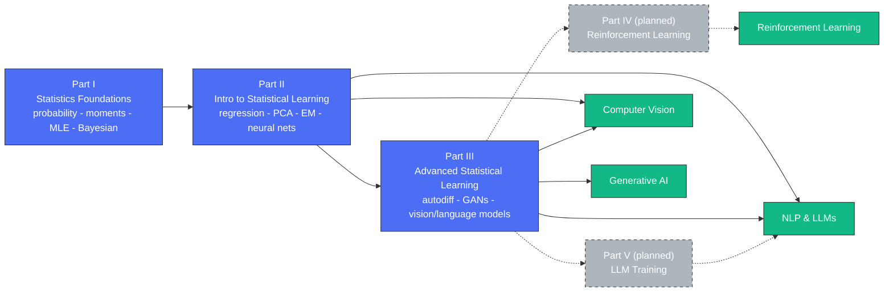

# Stat4ML

**Statistics and Mathematics for Machine Learning, Deep Learning, Deep NLP,
Reinforcement Learning, and LLM Training.**

This repository is Omid Safarzadeh's "trio" of courses -- Statistics
Foundation for ML, Introduction to Statistical Learning, and Advanced
Statistical Learning for DL -- combined into one book so the whole
sequence can be read and exercised together. See `ABOUT.md` for the
mission.

## Course map

How the three parts build on each other, and where they connect to the
deep learning applications you actually care about:



## The book

```
part1_statistics_foundations/         Part I:   Statistics Foundation for ML
part2_intro_statistical_learning/     Part II:  Introduction to Statistical Learning
part3_advanced_statistical_learning/  Part III: Advanced Statistical Learning for DL
```

Each chapter is its own folder (O'Reilly-style): a LaTeX/PDF chapter
text, a `source_slides/` copy of the original lecture slide PDF (when one
exists), a `homework/` copy of the original homework PDF (when one
exists), and **at least three homework exercises** in **Python, R, and
Rust**, each covering a different piece of the chapter's material --
every exercise, in every language, also gets a **Rustlings-style
broken-code counterpart**: fully working code with a few deliberate bugs
planted against the chapter's formulas/theorems, which you fix one at a
time until the tests pass.

Four chapters are fully authored end to end (text + all three languages'
exercises + buggy exercises, all verified to compile/run) as a reference
for the rest:
- `part1_statistics_foundations/ch00_matrix_algebra_review/`
- `part1_statistics_foundations/ch01_probability_theory_foundations/`
- `part1_statistics_foundations/ch02_moments/`
- `part2_intro_statistical_learning/ch01_learning_algorithms_overview/`

Every other chapter is scaffolded (folder structure, chapter README,
topic list, exercise stubs) so it has a consistent shape to fill in
later.

## Part I: Statistics Foundation for ML

Probability theory and mathematical statistics: sample spaces, random
variables, moments, the standard discrete/continuous distributions,
convergence concepts, and estimation (MLE and Bayesian).

**Course text:** Casella, G., & Berger, R. (2002). *Statistical
Inference* (2nd ed.). Cengage Learning.

### Prerequisites
- **Calculus:** derivatives (chain rule), integrals (techniques of
  integration, substitution, integration by parts). See
  `PreReq0_Calculus.pdf` (repository root -- no dedicated calculus
  chapter exists yet).
- **Matrix algebra:** matrix operations and multiplication, determinants,
  inverses, transposes, partitioned matrices, eigenvalues/eigenvectors,
  matrix decompositions (LU, Cholesky, QR, SVD), matrix differentiation.
  See `part1_statistics_foundations/ch00_matrix_algebra_review/source_slides/PreReq1_Matrix_Calculus.pdf`,
  now expanded into Chapter 0 below.

### Chapters
0. Matrix Algebra Review *(fully authored -- see `part1_statistics_foundations/ch00_matrix_algebra_review/`)*
1. Probability Theory Foundations *(fully authored -- see `part1_statistics_foundations/ch01_probability_theory_foundations/`)*
2. Moments *(fully authored -- see `part1_statistics_foundations/ch02_moments/`)*
3. Distribution Functions
4. Conditional and Multivariate Distributions
5. Convergence Concepts
6. Maximum Likelihood Estimation
7. Bayesian and Posterior Distribution Estimation

## Part II: Introduction to Statistical Learning

Core statistical/machine learning: regression, regularization, resampling,
unsupervised learning, EM, clustering, and the on-ramp into neural
networks and Transformers.

**Course texts:**
- James, G., Witten, D., Hastie, T., & Tibshirani, R. *An Introduction to
  Statistical Learning*.
- Murphy, K. *Machine Learning: A Probabilistic Perspective*.

### Chapters
1. Learning Algorithms Overview *(fully authored -- see `part2_intro_statistical_learning/ch01_learning_algorithms_overview/`)*
2. Regression, Cross-Validation
3. Logistic, Ridge, Lasso Regression
4. Recommendation Systems *(content gap)*
5. Unsupervised Learning, PCA
6. EM Algorithm
7. Clustering
8. NN, Activation and Loss Functions
9. Convolutional Neural Networks *(content gap)*
10. RNN, LSTM *(content gap)*
11. Language Models and Tokenization *(content gap)*
12. Transformers
13. Large Language Models *(content gap)*

## Part III: Advanced Statistical Learning for DL

Automatic differentiation, AutoML, GANs, multi-armed bandits, neural
architecture search, famous vision models, advanced language models, NLP
downstream tasks, speech processing, multi-modal models, Gaussian
processes, automatic feature extraction. See
`part3_advanced_statistical_learning/README.md` for the full chapter
list.

## Instructor

**Omid Safarzadeh**
LinkedIn: https://www.linkedin.com/in/omidsafarzadeh/
Instagram: @deepdatascientists

## License

This repository is licensed under the GNU General Public License v2
(GPLv2) -- see `LICENSE`.
