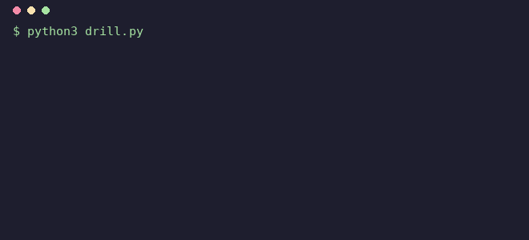
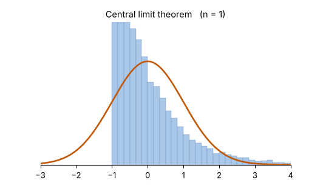
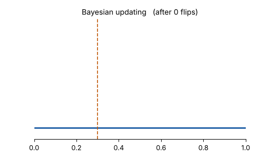
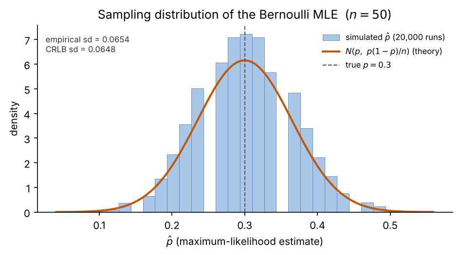
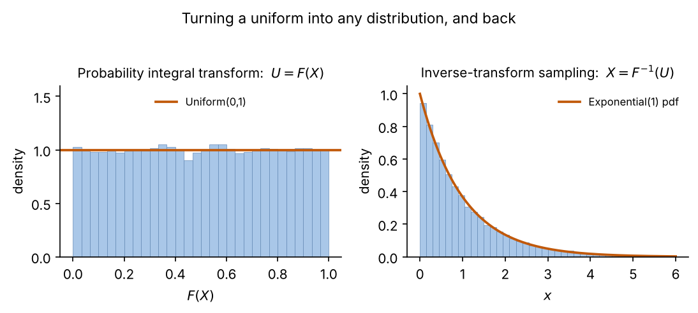
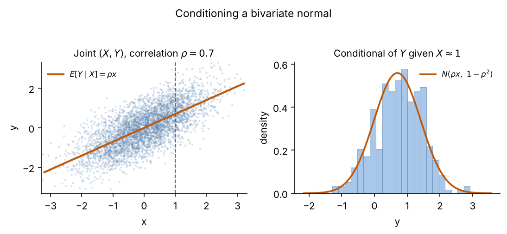
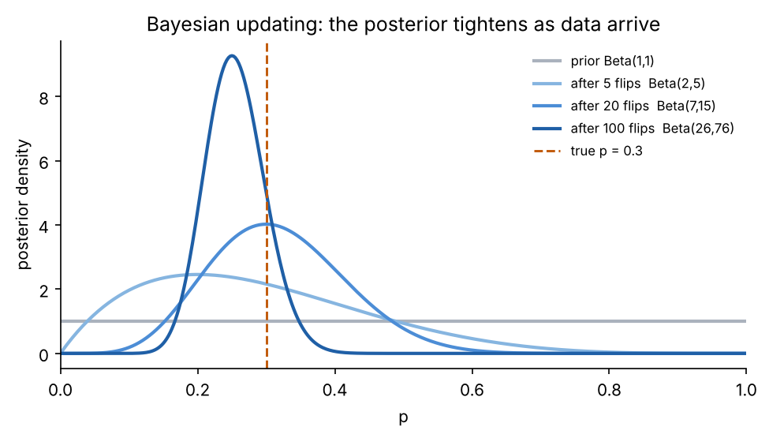
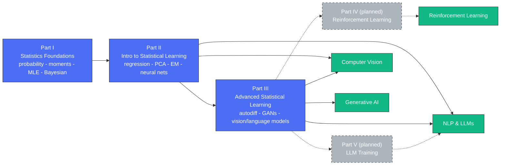

# Stat4ML

### The statistics behind machine learning — proven on paper, then debugged in code.

A free, self-paced course in the mathematics that modern machine learning actually
runs on — from probability and estimation up toward deep learning. Every idea is
worked out in full (definitions, theorems, **real proofs**), then handed to you as
code you run and fix yourself. Think *rustlings, for the math of ML*.

<p align="center">
  
</p>

Every exercise ships three ways — a from-scratch TODO, a **deliberately broken copy
whose bug breaks a specific theorem from the chapter**, and a reference solution — in
**Python and R**. You run it, read the first failing check, fix that one thing, and
watch it go green. You meet every idea twice: once building it, once debugging it.

## See the ideas move

The chapters don't just state results — they show them happening.

<table>
<tr>
<td align="center">
  <br/>
  <sub><b>Central limit theorem</b> — sample means of skewed data become normal.</sub>
</td>
<td align="center">
  <br/>
  <sub><b>Bayesian updating</b> — the posterior tightens onto the truth as data arrive.</sub>
</td>
</tr>
</table>

## What's in a chapter

- **The chapter, written out properly.** Not slide bullets — prose with real
  definitions, theorems, and worked proofs, colour-typeset so you can tell a
  definition from a theorem from an aside at a glance. PDF, with the LaTeX source
  beside it.
- **Worked code, inline.** A short Python gallery next to the maths (the MLE for ten
  distributions, the CLT across three sources, conjugate Bayesian updates), and a
  simulation figure that makes the key theorem something you *watch happen*.
- **Three exercises, in Python and R**, each covering a different piece of the chapter
  — a from-scratch TODO, a broken copy to debug, and a reference solution.
- **The original lecture slides and homework**, exactly as taught, when they exist.

Nothing to install: the Python exercises use only the standard library, the R ones
only base R.

## Drill it yourself

`drill.py` walks the course one exercise at a time, rustlings-style: run it, read the
first failing check, fix the file, watch it pass, move on. It only ever hands you
exercises whose reference solution actually runs, so unfinished chapters are skipped.

```bash
python3 drill.py           # run the next unfinished exercise
python3 drill.py watch     # rerun automatically every time you save
python3 drill.py list      # see every exercise and its status
python3 drill.py verify    # check every ready exercise is sound
```

By default you fix the deliberately broken copies (`--track debug`); pass
`--track build` to fill in the TODO versions from scratch. Python runs out of the box;
add R with `--lang both` once `Rscript` is installed.

**Drill at your level.** Every exercise is tagged `core` / `proof` / `research`, so the
course scales with you:

```bash
python3 drill.py --level bachelor   # core: results, intuition, code
python3 drill.py --level master     # + the proofs
python3 drill.py --level phd        # + research-grade extensions
```

## A look inside

<table>
<tr>
<td align="center" width="50%">
  <br/>
  <sub>Ch.6 — the MLE's sampling distribution meets the Cramér–Rao floor.</sub>
</td>
<td align="center" width="50%">
  <br/>
  <sub>Ch.3 — turning a uniform into any distribution, and back.</sub>
</td>
</tr>
<tr>
<td align="center" width="50%">
  <br/>
  <sub>Ch.4 — conditioning a bivariate normal.</sub>
</td>
<td align="center" width="50%">
  <br/>
  <sub>Ch.7 — the posterior sharpening onto the true value.</sub>
</td>
</tr>
</table>

## Start here

**Part I (Statistics Foundations) is complete — eight chapters, end to end.** Read it
in order from Chapter 0, or jump to a flagship chapter to see the format:

| Chapter | Why start here |
|---|---|
| [Maximum Likelihood Estimation](part1_statistics_foundations/ch06_maximum_likelihood_estimation/) | proofs + an MLE cookbook for ten distributions + the efficiency simulation |
| [Convergence Concepts](part1_statistics_foundations/ch05_convergence_concepts/) | the law of large numbers and the CLT, proven and simulated |
| [Bayesian Estimation](part1_statistics_foundations/ch07_bayesian_estimation/) | conjugacy, credible intervals, and the bridge back to maximum likelihood |

If you're new to the material, start at
[Chapter 0](part1_statistics_foundations/ch00_matrix_algebra_review/) and read Part I
in order. You'll need calculus (chain rule, integration by parts —
see [`PreReq0_Calculus.pdf`](PreReq0_Calculus.pdf)); Chapter 0 covers the matrix
algebra from scratch.

## Course map

How the parts build on each other, and where each one lands in practice:



Each chapter is marked **complete** (written chapter + six exercises, three each in
Python and R, with a broken copy of each), **slides only** (lecture slides are there to
learn from; the written chapter isn't done), or **not started**.

## Part I: Statistics Foundations for ML — complete

Probability theory and mathematical statistics: random variables, moments, the standard
distributions and their transforms, convergence (the law of large numbers and the CLT),
and estimation (maximum likelihood and Bayesian).

**Course text:** Casella, G., & Berger, R. (2002). *Statistical Inference* (2nd ed.).

| # | Chapter | Status |
|---|---|---|
| 0 | Matrix Algebra Review | **complete** |
| 1 | Probability Theory Foundations | **complete** |
| 2 | Moments | **complete** |
| 3 | Distribution Functions | **complete** |
| 4 | Conditional and Multivariate Distributions | **complete** |
| 5 | Convergence Concepts | **complete** |
| 6 | Maximum Likelihood Estimation | **complete** |
| 7 | Bayesian and Posterior Distribution Estimation | **complete** |

## Part II: Introduction to Statistical Learning

Regression, regularization, resampling, unsupervised learning, EM, clustering, and the
on-ramp into neural networks and Transformers.

**Course texts:** James, Witten, Hastie & Tibshirani, *An Introduction to Statistical
Learning*; Murphy, *Machine Learning: A Probabilistic Perspective*.

| # | Chapter | Status |
|---|---|---|
| 1 | Learning Algorithms Overview | **complete** |
| 2 | Regression, Cross-Validation | **complete** |
| 3 | Logistic, Ridge, Lasso Regression | **complete** |
| 4 | Recommendation Systems | not started |
| 5 | Unsupervised Learning, PCA | **complete** |
| 6 | EM Algorithm | **complete** |
| 7 | Clustering | slides only |
| 8 | NN, Activation and Loss Functions | slides only |
| 9 | Convolutional Neural Networks | not started |
| 10 | RNN, LSTM | not started |
| 11 | Language Models and Tokenization | not started |
| 12 | Transformers | slides only |
| 13 | Large Language Models | not started |

## Part III: Advanced Statistical Learning for DL

The deep-learning end of the sequence: automatic differentiation, GANs, multi-armed
bandits, well-known vision and language models, Gaussian processes, and more. See
[`part3_advanced_statistical_learning/`](part3_advanced_statistical_learning/) for the
full chapter list.

## Instructor

**Omid Safarzadeh**
LinkedIn: https://www.linkedin.com/in/omidsafarzadeh/ · Instagram: @deepdatascientists

## License

GNU General Public License v2 (GPLv2) — see [`LICENSE`](LICENSE).
