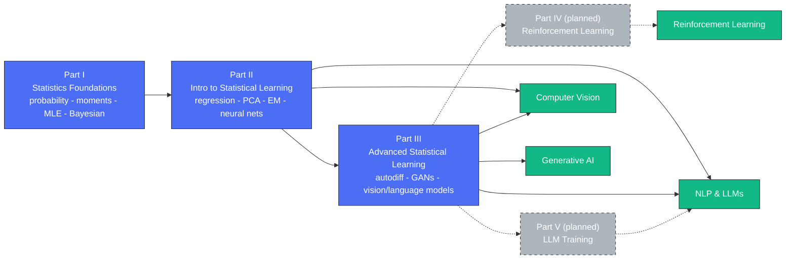

# Stat4ML

**Statistics and Mathematics for Machine Learning, Deep Learning, Deep NLP,
Reinforcement Learning, and LLM Training.**

A free, self-paced course in the statistics that modern machine learning
actually runs on -- from probability and moments up through neural
networks, Transformers, and LLMs. Every idea is worked out in full, then
handed to you as code you run and fix yourself.

## What's in a chapter

- **The chapter, written out properly.** Not slide bullets -- prose with
  real definitions, theorems, and worked examples, colour-typeset so you
  can tell a definition from a theorem from an aside at a glance. PDF,
  with the LaTeX source next to it.
- **The original lecture slides**, exactly as taught, when they exist.
- **Three homework exercises, each in Python and R.** Each one
  covers a different piece of the chapter -- not the same formula three
  times.
- **A broken copy of every exercise.** Working code with a few bugs
  planted in it on purpose, each one breaking a specific formula or
  theorem from the chapter. Run the tests, watch them fail, fix them one
  at a time. You meet every idea twice: once building it, once debugging
  it.

Nothing to install: the Python exercises use only the standard library,
the R ones only base R, and nothing else.

```bash
python3 exercise01_buggy.py                                   # Python
Rscript exercise01_buggy.R                                    # R
```

## Drill it yourself

`drill.py` walks the course one exercise at a time, rustlings-style: run it,
read the first failing check, fix the file, watch it pass, move on. It only
ever hands you exercises whose reference solution actually runs, so
unfinished chapters are skipped automatically.

```bash
python3 drill.py           # run the next unfinished exercise
python3 drill.py watch     # rerun automatically every time you save
python3 drill.py list      # see every exercise and its status
python3 drill.py verify    # check every ready exercise is sound (used in CI)
```

By default you fix the deliberately broken copies (`--track debug`); pass
`--track build` to fill in the TODO versions from scratch instead, or
`--track both` for the full pass. Python runs out of the box; add R with
`--lang both` once `Rscript` is installed. Progress is kept in
`drill_state.json`. Chapters whose exercises are tagged by difficulty can be drilled by level -- `--level bachelor|master|phd` serves only the tiers at or below that level (Chapter 6 in Part I is the first chapter with level-tagged exercises).

## Start here

Four chapters are finished end to end and are the best way in:

| Chapter | Folder |
|---|---|
| Matrix Algebra Review | [`part1_statistics_foundations/ch00_matrix_algebra_review/`](part1_statistics_foundations/ch00_matrix_algebra_review/) |
| Probability Theory Foundations | [`part1_statistics_foundations/ch01_probability_theory_foundations/`](part1_statistics_foundations/ch01_probability_theory_foundations/) |
| Moments | [`part1_statistics_foundations/ch02_moments/`](part1_statistics_foundations/ch02_moments/) |
| Learning Algorithms Overview | [`part2_intro_statistical_learning/ch01_learning_algorithms_overview/`](part2_intro_statistical_learning/ch01_learning_algorithms_overview/) |

If you're new to the material, read Part I in order starting at Chapter 0.
If you already know your probability, jump to Part II.

## Course map

How the parts build on each other, and where each one lands in practice:



## How far along each chapter is

This is a work in progress, and the chapter lists below say plainly where
each one stands:

- **complete** -- written chapter, plus six exercises (three each in
  Python and R) and a broken copy of each to fix.
- **slides only** -- the original lecture slides are in the folder and you
  can learn from them today; the written-out chapter isn't done yet.
- **not started** -- no slides and no text yet; the folder is a
  placeholder.

## Part I: Statistics Foundation for ML

Probability theory and mathematical statistics: sample spaces, random
variables, moments, the standard discrete and continuous distributions,
convergence concepts, and estimation (maximum likelihood and Bayesian).

**Course text:** Casella, G., & Berger, R. (2002). *Statistical
Inference* (2nd ed.). Cengage Learning.

**You'll need first:** calculus (chain rule, integration by substitution
and by parts) -- see [`PreReq0_Calculus.pdf`](PreReq0_Calculus.pdf) -- and
matrix algebra, which Chapter 0 below covers from scratch.

| # | Chapter | Status |
|---|---|---|
| 0 | Matrix Algebra Review | **complete** |
| 1 | Probability Theory Foundations | **complete** |
| 2 | Moments | **complete** |
| 3 | Distribution Functions | **complete** |
| 4 | Conditional and Multivariate Distributions | **complete** |
| 5 | Convergence Concepts | **complete** |
| 6 | Maximum Likelihood Estimation | **complete** |
| 7 | Bayesian and Posterior Distribution Estimation | slides only |

Chapters 1-7 also carry the original homework PDF from the course, in each
chapter's `homework/` folder.

## Part II: Introduction to Statistical Learning

Regression, regularization, resampling, unsupervised learning, EM,
clustering, and the on-ramp into neural networks and Transformers.

**Course texts:**
- James, G., Witten, D., Hastie, T., & Tibshirani, R. *An Introduction to
  Statistical Learning*.
- Murphy, K. *Machine Learning: A Probabilistic Perspective*.

| # | Chapter | Status |
|---|---|---|
| 1 | Learning Algorithms Overview | **complete** |
| 2 | Regression, Cross-Validation | slides only |
| 3 | Logistic, Ridge, Lasso Regression | slides only |
| 4 | Recommendation Systems | not started |
| 5 | Unsupervised Learning, PCA | slides only |
| 6 | EM Algorithm | slides only |
| 7 | Clustering | slides only |
| 8 | NN, Activation and Loss Functions | slides only |
| 9 | Convolutional Neural Networks | not started |
| 10 | RNN, LSTM | not started |
| 11 | Language Models and Tokenization | not started |
| 12 | Transformers | slides only |
| 13 | Large Language Models | not started |

## Part III: Advanced Statistical Learning for DL

The deep learning end of the sequence: automatic differentiation, AutoML,
GANs, multi-armed bandits, neural architecture search, well-known vision
models, advanced language models, NLP downstream tasks, speech processing,
multi-modal models, Gaussian processes, and automatic feature extraction.

Chapter 12 (Automatic Feature Extraction) has its original slides; the
rest of this part is not started yet. See
[`part3_advanced_statistical_learning/`](part3_advanced_statistical_learning/)
for the full chapter list.

## Instructor

**Omid Safarzadeh**
LinkedIn: https://www.linkedin.com/in/omidsafarzadeh/
Instagram: @deepdatascientists

## License

GNU General Public License v2 (GPLv2) -- see [`LICENSE`](LICENSE).
